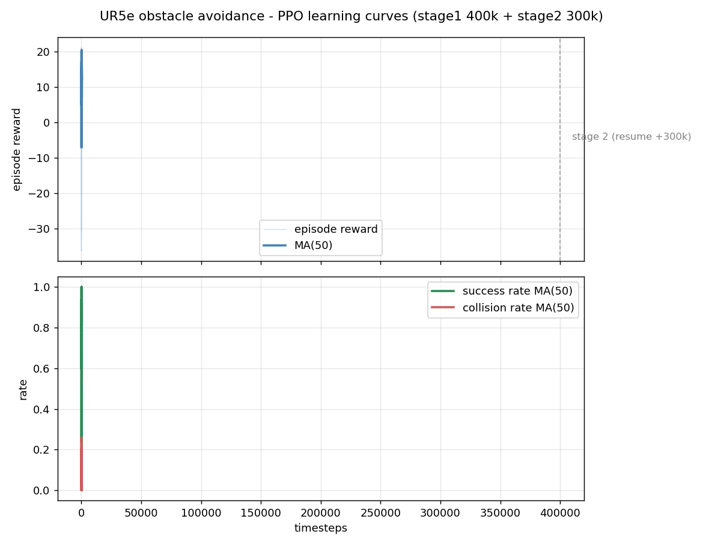
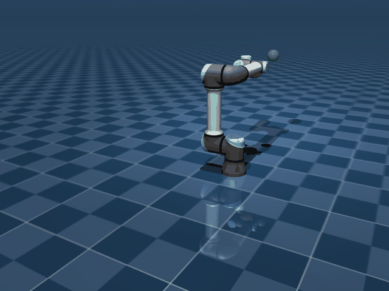

# UR5e + PPO 避障控制：从零到 99% 成功率

> 任务一句话：让 UR5e 机械臂从 home 位形出发，绕过红色球形障碍物，把末端送到绿色目标球（误差 < 5cm），整个策略用 PPO（近端策略优化）从零学出来。

**最终成绩**（difficulty=1，100 回合确定性评估）：

| 指标 | 数值 |
|---|---|
| 成功率 | **99%** |
| 碰撞率 | 1% |
| 超时率 | 0% |
| 平均回合长度 | 16.9 步（约 0.17s 仿真时间） |





训练总量：stage1 400k 步 + stage2 续训 300k 步，纯 CPU 约 12 分钟。

---

## 1. 文件结构

```
ur5e_ppo/
├── models/universal_robots_ur5e/   # UR5e 模型（MuJoCo Menagerie 副本，MIT 协议）
│   ├── ur5e.xml                    #   机械臂本体：6 关节 + 位置 PD 伺服执行器
│   └── ur5e_ppo_scene.xml          #   ★ 本项目的场景：地面 + 障碍物 + 目标球
├── ur5e_obstacle_env.py            # ★ 避障环境（Gymnasium 接口，MDP 定义在这）
├── train_ppo.py                    # ★ PPO 训练脚本（超参数在这）
├── evaluate.py                     # ★ 评估：成功率统计 / GIF / 实时窗口
├── runs/ppo_ur5e/
│   ├── best_model.zip              #   训练好的策略（拿来就能用）
│   ├── learning_curve.png          #   学习曲线 + 成功率曲线
│   └── demo.gif                    #   策略演示动画
└── requirements.txt
```

## 2. 快速开始

需要 Python 3.10+：

```bash
pip install -r requirements.txt

# 环境自检（随机策略 + 仿真速度测试）
python ur5e_obstacle_env.py

# 从头训练（CPU 约 10 分钟；40 万步成功率约 70%）
python train_ppo.py --timesteps 400000

# 想要 99% 成功率？从 checkpoint 续训 30 万步
python train_ppo.py --timesteps 300000 \
    --resume runs/ppo_ur5e/best_model.zip \
    --run-dir runs/ppo_ur5e_stage2

# 评估：100 回合统计 + 生成演示 GIF
python evaluate.py

# 实时 3D 窗口肉眼看策略表现
python evaluate.py --viewer

# 加大难度（障碍物更大、更挡路）
python train_ppo.py --difficulty 2
```

所有脚本按**文件夹内相对路径**找模型，在 `ur5e_ppo/` 目录下运行即可，无需配置绝对路径。

## 3. 任务是怎么定义的（MDP 五要素）

强化学习的一切都归结为马尔可夫决策过程（MDP）：**状态、动作、奖励、转移、终止**。转移（物理仿真器）是黑盒不用管，你要设计的是其余四样——**改任务 = 改这四样**。

| 要素 | 本项目的取值 | 设计理由 |
|---|---|---|
| **状态 S**（31 维） | 关节角 6 + 关节速度 6 + EE 位置 3 + EE→目标向量 3 + 4 个臂上点到障碍物向量 12 + 障碍物半径 1 | 策略必须"看得见"障碍物对**整条手臂**的威胁，只给 EE 位置的话，手腕撞了它都不知道为什么挨罚 |
| **动作 A**（6 维） | 每维 ∈ [-1,1]，映射为 6 个关节**位置控制目标**的增量（每步最多 ±0.25 rad） | UR5e 的执行器自带 PD 伺服（gainprm=2000, biasprm="0 -2000 -400"），我们只发"目标角度"，力矩由 MuJoCo 算——真实机器人也这么控 |
| **奖励 R** | 见第 4 节逐项表 | 密集奖励（每步都有反馈）是短时间能学出来的关键 |
| **终止** | 成功（EE 距目标 < 5cm）/ 撞障碍物 / 200 步超时 | 二选一的博弈：快 vs 安全 |

每回合随机采样目标点位置、障碍物位置和半径；目标采样带**可达性约束**（水平半径压在 [0.30, 0.68]m，UR5e 臂展约 0.85m），避免采到物理上够不着的目标污染训练信号。

## 4. 奖励函数逐项拆解（`ur5e_obstacle_env.py` 的 `_reward_info`）

| 项 | 公式 | 数量级 | 人话 |
|---|---|---|---|
| 进度奖励 | `4.0 × (d_上一步 − d_本步骤)` | 单步 ±0.05 | **每靠近目标一点就给钱**。用前后差分（势能差形式），磨蹭回去就要吐出来 |
| 距离惩罚 | `−0.05 × d` | 单步 −0.02 左右 | 离得越远，站着的每一步都在扣钱，催它别磨蹭 |
| 时间惩罚 | `−0.02`（常数） | 回合最多 −4 | 活着就有成本 |
| 动作代价 | `−0.005 × Σaᵢ²` | 单步 −0.03 左右 | 大幅度乱甩要罚款 → 轨迹平滑、省力 |
| 成功奖励 | `+20`（一次性） | — | 终点大红包 |
| 碰撞惩罚 | `−20`（一次性，回合终止） | — | 撞车直接出局，和成功红包等额——**安全 > 任务** |

一个值得体会的细节：碰撞 −20 不小于成功 +20。如果成功奖励远大于碰撞惩罚，策略会学会"赌一把穿过去"——奖励设计就是在写你想要的价值观。

## 5. PPO 到底在干什么

### 5.1 先建立直觉（别急着看公式）

想象你在学开车，教练（环境）每一步都给你打分（奖励）。你有两种极端学法：

- **学得太猛**：一次失误就彻底推翻所有经验 → 策略震荡，永远学不会；
- **学得太怂**：每次只改一点点 → 学到天荒地老。

PPO 的核心思想就一句话：**每次更新，策略最多变一点点（约 20%），变太多的方向直接不许动。** 这就是名字里 "Proximal"（近端）的含义——只在旧策略的"邻近"找新策略。

### 5.2 训练循环（train_ppo.py 里发生的事）

```
┌─ 采数据：当前策略跑 3072 步（6 个并行环境 × 512 步）
│
├─ 算优势：每步动作"比平均水平好多少"（GAE：用价值网络估计的回报做基线）
│
├─ 更新：同一批数据重复学 10 遍（n_epochs）
│    每遍把"新旧策略概率比"限制在 [1−ε, 1+ε]（ε=0.2）
│    → 这就是 clipping，PPO 的灵魂
│
└─ 回到第一步，用新策略继续采
```

**优势（advantage）为什么重要**：不加基线时，所有"回报为正"的动作都被加强，哪怕这个动作其实比平均水平差。减去基线后，只有"比平均好"的动作才被加强——同一个信号，信噪比高得多。

### 5.3 超参数速查表（都在 `train_ppo.py` 里，鼓励动手改）

| 超参 | 默认值 | 改大会怎样 | 改小会怎样 |
|---|---|---|---|
| `learning_rate` | 3e-4 | 学得快但容易崩（曲线发散） | 稳但慢 |
| `n_steps` | 512×6环境 | 更新频率低、样本效率高 | 更新频繁、数据更"新鲜" |
| `batch_size` | 256 | 梯度更稳 | 更新更频繁 |
| `gamma` | 0.99 | 更有远见（看得见 100 步外的成功奖励） | 目光短浅，只顾眼前 |
| `clip_range` | 0.2 | 每步敢变更多（快但险） | 保守（稳但慢） |
| `ent_coef` | 0.008 | 更爱探索（避免过早躺平） | 更快收敛但可能陷入局部最优 |
| `net_arch` | [128,128] | 表达力强、易过拟合、慢 | 快但可能学不动 6 关节耦合 |

### 5.4 为什么选 PPO

- **样本效率 vs 稳定性的甜点位**：on-policy（只用最新策略的数据）费样本但极其稳定，不挑超参——这是它统治机器人仿真训练的原因。
- SAC/TD3 等 off-policy 方法样本效率更高，但超参敏感、发散了不容易察觉——第一课别上来就挑战地狱模式。
- 无独显的机器 → CPU 上 PPO + 小网络是最省心的组合（本项目 70 万步仅约 12 分钟）。

## 6. 怎么判断训练得好不好

看 `runs/ppo_ur5e/learning_curve.png`（即上方第一张图）：

1. **上：回合奖励**。蓝细线是每回合原始值（噪声大是正常的），蓝粗线是 50 回合滑动平均——**只看粗线**。健康形状：先降（乱动挨罚）→ 稳定爬升 → 平台。
2. **下：成功率/碰撞率**（滑动平均）。本项目最终：绿线 98%+，红线 2% 以下。

**体检 checklist**：

| 症状 | 诊断 | 药方 |
|---|---|---|
| 成功率高但碰撞率也高 | 惩罚不够狠 | 碰撞惩罚 −20 → −30，或 `--difficulty 2` 重训 |
| 什么都不学，奖励躺平 | 奖励信号太弱 / 探索不够 | 进度奖励 4.0 → 6.0；`ent_coef` 0.008 → 0.015 |
| 曲线发散、越来越差 | 学习率太大 | `learning_rate` → 1e-4 |
| 学会了但磨磨蹭蹭 | 时间/距离惩罚太轻 | 时间惩罚 −0.02 → −0.05 |
| 训练集好、新种子差 | 过拟合随机种子 | 多换几个 `--seed` 训练对比 |

## 7. 往哪儿扩展（按工作量排序）

1. **难度课程**：`difficulty=0` 训 10 万步 → `--resume` 继续 `difficulty=1` → `2`。先易后难，收敛快得多。
2. **动态障碍物**：在 `step()` 里每步给 `model.geom_pos[obstacle]` 加一个速度——注意观测里要加障碍物速度，不然它"看不见"运动。
3. **全臂防撞**：现在障碍物位置在观测里是 4 个关键点；可以换成每个碰撞 geom 的最近距离（更精细但观测维度暴涨）。
4. **视觉观测**：把 31 维状态换成相机渲染图像 + CNN 策略（`CnnPolicy`）——CPU 会很吃力，慎重。
5. **Sim2Real 注意**：位置控制接口、域随机化（摩擦/负载/控制延迟扰动）是迁移到实机的两大命门，这个框架已经把控制接口做对了。

## 8. 踩坑记录（真实踩过的）

- **可达性约束很重要**：早期版本目标采样框能采到水平半径 0.85m（UR5e 极限臂展）的点，那些回合物理上不可能成功，20 万步训练成功率只有 2%。加上 [0.30, 0.68] 的半径约束后，同样的 40 万步成功率冲到 71%。
- **观测里必须给障碍物信息**：只给 EE 位置时策略永远学不会避障（手腕撞了却看不见），加上 4 个臂上点的相对向量后才通。
- **Menagerie 路径**：MuJoCo 的 `<include>` 相对路径以**主 XML 所在目录**解析，所以直接引用别处的 menagerie 路径会导致 mesh 找不到——复制整个模型目录才是干净做法（本仓库已带）。
- **40 万步没到顶就续训**：第一段训练结束时成功率还在爬升（71%），`--resume` 续训 30 万步到 99%。曲线没平就停，等于白练一半。

## 致谢

- 机器人模型来自 [MuJoCo Menagerie](https://github.com/google-deepmind/mujoco_menagerie)（MIT License）
- 训练框架 [stable-baselines3](https://github.com/DLR-RM/stable-baselines3)（MIT License）
